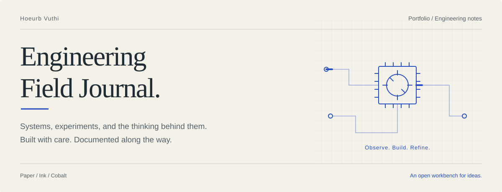

<p align="center">
  
</p>

# Engineering Field Journal

Hoeurb Vuthi’s personal portfolio: an open notebook of engineering work, experiments, and the decisions behind them. Warm paper, serif typography, fine rules, and cobalt drawings give the work room to speak.

[Explore the code](src/pages/index.astro) · [Project records](src/data/projects.ts) · [Get started](#get-started) · [Verification](#verification)

## A little life on the page

- **A living wordmark.** Square particles scatter and reassemble; the project heading cycles through *documented.*, *explored.*, *built.*, and *refined.*
- **A working desk.** Keycaps, washers, paper clips, and a pencil drift, collide, and respond to dragging and scrolling.
- **An engineering journal.** Twenty project records, searchable and filterable, with detailed notes and schematic illustrations.
- **A portfolio assistant.** A server-side DeepSeek integration with streamed responses, request limits, and explicit error states.
- **Considered motion.** Pause controls, reduced-motion fallbacks, and hidden/offscreen suspension keep animation intentional.

The header above uses a self-contained SVG: no external image service, scripts, or tracking. Its opening animation settles after eight seconds and respects reduced-motion preferences in supporting viewers.

## Get started

Use **Node.js 22.12 or newer** and npm.

```sh
npm ci
npm run dev:review
```

Open **[localhost:4322](http://localhost:4322)**. The review command keeps the development server in the foreground. For the standard development server at port 4321, use `npm run dev`.

### Configure the assistant

Create a local `.env` from [.env.example](.env.example) if you do not already have one. Keep any existing local configuration.

```dotenv
DEEPSEEK_API_KEY=your_private_key_here
DEEPSEEK_MODEL=deepseek-v4-flash
```

Enter your own key locally and restart the development server. `DEEPSEEK_API_KEY` stays on the server; do not give it a `PUBLIC_` prefix. The optional model setting defaults to `deepseek-v4-flash`; use a model available to your provider account. `.env` files are ignored by Git; the safe example remains versioned.

The contact form supports `PUBLIC_WEB3FORMS_ACCESS_KEY`. It uses the existing public form identifier when no override is supplied. Real inbox delivery requires a working provider configuration.

## On the workbench

| Layer | Tools |
| :--- | :--- |
| Pages & server routes | Astro 7, TypeScript |
| Styling | Tailwind CSS v4, CSS custom properties |
| Interaction | Vanilla JavaScript, Canvas, SVG |
| Assistant | DeepSeek, server-side streaming |
| Deployment build | Vercel adapter, patched `nodejs22.x` runtime |
| Verification | Playwright, API fixtures, physics regressions, local QC |

The home and project journal are prerendered; `/api/chat` runs on the server. Site typography is self-hosted, with a paper `#f4f1e9`, ink `#202c33`, and cobalt `#244dc8` palette.

## Find your way

```text
src/
├── pages/          Home, project journal, 404, and chat API
├── components/     Wordmarks, desk motion, schematics, and dialogs
├── data/           Project records
├── styles/         Theme tokens and responsive layouts
└── utils/          Collision physics and drafting geometry
scripts/            Quality gates and review captures
tests/              API, physics, and browser regressions
docs/assets/        README artwork
```

| Start here | Purpose |
| :--- | :--- |
| [Home](src/pages/index.astro) | Portfolio entry point |
| [Project journal](src/pages/projects.astro) | Search, filters, and project records |
| [Theme](src/styles/global.css) | Paper, ink, cobalt, and typography |
| [Drafting field](src/components/DraftingField.astro) | Interactive desktop objects |
| [Assistant](src/components/NekoWidget.astro) | Chat interface |
| [Chat endpoint](src/pages/api/chat.ts) | Provider integration and request limits |

## Verification

Run the primary quality gate and fixtures after changes:

```sh
npm run qc
npm run test:api
npm run test:physics
```

With the review server running at port 4322, check browser behavior and capture the site:

```sh
npm run test:browser
npm run review:capture
```

Browser checks use Chromium at `/usr/bin/chromium`; adjust [playwright.config.ts](playwright.config.ts) for another installation. QC checks encoding, the chat wrapper invariant, whitespace/conflicts, the production build, and the required `nodejs22.x` runtime patch.

To create a production build:

```sh
npm run build
```

## Project records

This repository contains the runnable redesign. Canonical specifications and implementation history live in the separate local [vault project](../second-brain/01-projects/web-personal-redesign-v2/README.md); those links require the companion vault and are unavailable in a standalone GitHub checkout.

The original portfolio and earlier mockup remain separate. Retained legacy components are reference material; the current routes and approved redesign specifications define this site.

---

*Observe carefully. Build deliberately. Leave useful notes.*
