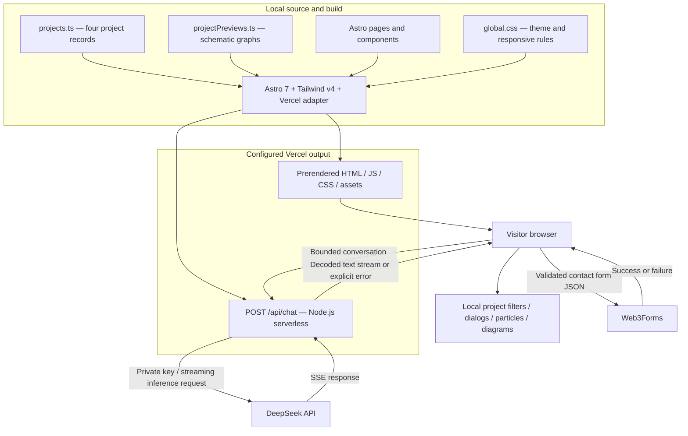
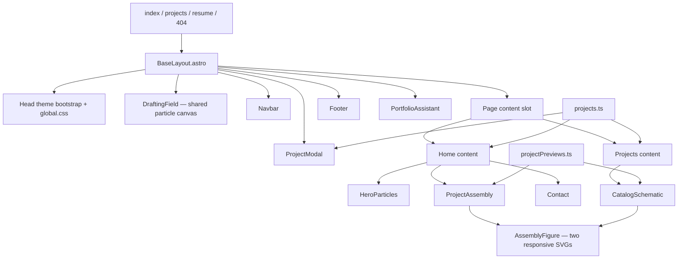
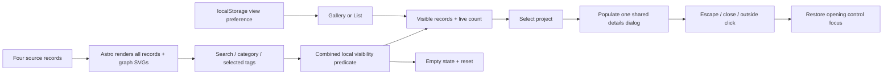
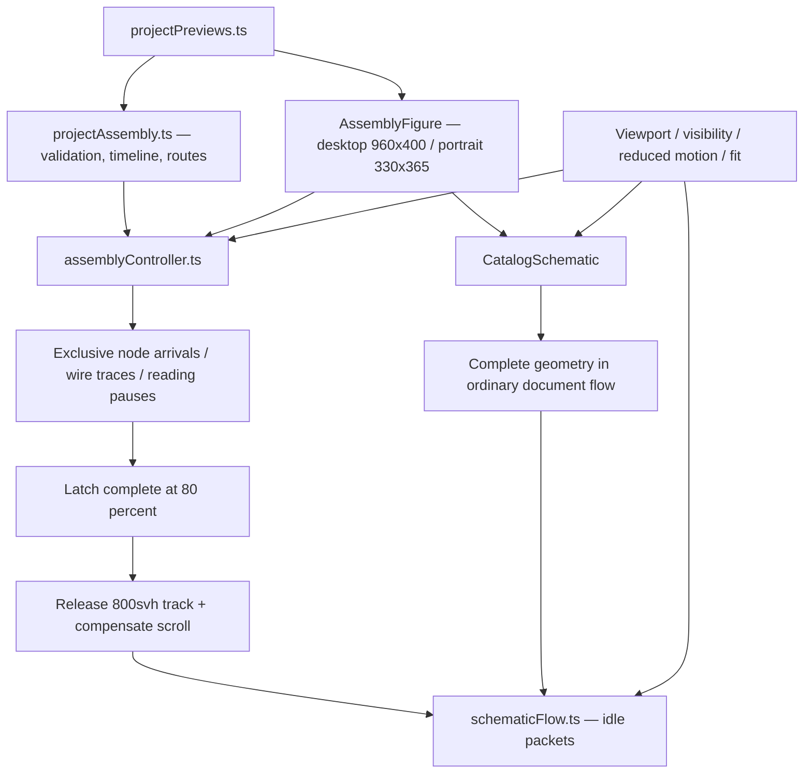

# Portfolio Website — project schematic

Source snapshot: 2026-10-21. Package: `web-personal-redesign-v2`. This document maps the current isolated implementation, inspected without opening environment files. It describes source behavior; it does not establish production deployment health or real provider delivery.

## 1. System boundary

This portfolio is an Astro site with prerendered pages and one serverless chat endpoint. Project exploration and animation run in the browser. Chat inference passes through the server; contact submission goes directly to an external form provider. There is no application database, authentication service, background worker or durable chat store in this project.



The compact on-site graph in [projectPreviews.ts](src/data/projectPreviews.ts), record `02`, follows this map with nine nodes and nine directed relationships. UI→API and contact→provider arrows summarize round trips; separate DeepSeek arrows distinguish the inference request and streamed response. It is rendered on `/projects#project-02`. Home currently selects records `01`, `04` and `03`, so the Portfolio diagram is not a homepage study.

## 2. Runtime and route map

| Route | Rendering | Responsibility |
| --- | --- | --- |
| `/` | Prerendered | Hero particles, three selected schematic studies, biography, skills and contact form |
| `/projects` | Prerendered | Four project records, search, category/tag filters, Gallery/List, complete schematic diagrams and details |
| `/resume` | Prerendered | Resume standby page with contact and projects actions |
| `/404` / unmatched paths | Prerendered 404 document | Missing-page navigation, using the shared site shell |
| `POST /api/chat` | Serverless | Input validation, local rate accounting, DeepSeek request and streaming translation |
| `/resume.pdf` | Configured HTTP 302 redirect | Redirects legacy resume bookmarks to `/resume` |

[astro.config.mjs](astro.config.mjs) uses `output: 'server'`, the Vercel adapter and Tailwind's Vite plugin. Individual content pages opt into prerendering; the chat route opts out. Node.js ≥22.12.0 is required by the package. The build script patches the generated function runtime to `nodejs22.x`.

## 3. Components and ownership



| Source | Owns |
| --- | --- |
| [BaseLayout.astro](src/layouts/BaseLayout.astro) | Metadata, self-hosted font preload, theme initialization, shared shell and dialog keyboard handling |
| [projects.ts](src/data/projects.ts) | Stable `num`, title, description, tags, category, features and optional live URL; currently four records |
| [projectPreviews.ts](src/data/projectPreviews.ts) | Graph summaries, captions, factual/illustrative flag, nodes, orthogonal routes, ports and both responsive placements |
| [projects.astro](src/pages/projects.astro) | Filter state, count/empty recovery, view persistence and stable hash destinations |
| [ProjectModal.astro](src/components/ProjectModal.astro) | Escaped embedded record JSON, safe text rendering, native modal details and focus restoration |
| [PortfolioAssistant.astro](src/components/PortfolioAssistant.astro) | Non-modal chat dialog, incremental text, history, retry/reset, mobile viewport fit |
| [Contact.astro](src/components/Contact.astro) | Field validation, direct Web3Forms submission, pending/error/success states and heading typewriter |
| [global.css](src/styles/global.css) | Paper/ink/cobalt light palette, dark palette, typography, shared controls, responsive layouts and schematic states |

The assistant's `#neko-chat` ID and inner `flex h-full min-h-0 flex-col overflow-hidden` wrapper are required invariants. The wrapper also has `assistant-shell`; preserve its critical class sequence. Interaction uses vanilla JavaScript/TypeScript compiled by Astro, without a UI framework.

## 4. Project exploration flow



Search matches the rendered lowercase title, description and technologies. Category and technology conditions combine with search; every selected technology must match. Filtering changes DOM visibility rather than fetching new records. Gallery/List is saved under `journal-project-view`. Hash anchors use stable record numbers such as `#project-02`. Project content is serialized once for the dialog with `<` escaped, and dialog text is inserted with `textContent`. Only Portfolio Website has a supplied live URL; unpublished records do not gain invented links.

## 5. Assistant request and streaming contract

```mermaid
sequenceDiagram
    actor Visitor
    participant Panel as PortfolioAssistant
    participant API as POST /api/chat
    participant Provider as DeepSeek
    Visitor->>Panel: Ask question (up to 250 characters)
    Panel->>Panel: Disable request controls; create answer bubble
    Panel->>API: JSON messages (last six completed messages + question)
    API->>API: Validate body, roles, history and final user turn
    API->>API: Require private key; enforce per-instance limits
    API->>Provider: System facts + last six messages, stream=true
    loop Provider response chunks
        Provider-->>API: SSE data lines
        API->>API: Decode UTF-8, retain partial lines, parse deltas
        API-->>Panel: Plain text chunks
        Panel->>Panel: Append textContent; scroll conversation
    end
    Provider-->>API: DONE or finish_reason completion
    API-->>Panel: Close completed stream
    Panel->>Panel: Save completed user/assistant pair in page memory
    Panel-->>Visitor: Response complete
    Note over Panel,Provider: On failure: discard partial answer, preserve question, offer retry
```

The provider endpoint is `https://api.deepseek.com/v1/chat/completions`. `DEEPSEEK_API_KEY` is server-only. `DEEPSEEK_MODEL` is optional and defaults to `deepseek-flash`; the legacy configured alias `deepseek-v4.1-flash` is normalized to that identifier. The prompt contains curated portfolio facts; it is not generated dynamically from project records and has no retrieval or tool execution.

| Boundary | Implemented constraint |
| --- | --- |
| Request body | Reject declared content length over 16,384; also reject read text length over 16,384 |
| Message history | 1–12 messages; only `user` / `assistant`; nonempty string content ≤4,000 characters |
| Latest question | Final role must be `user`; ≤250 characters |
| Provider context | System facts plus the last six submitted messages; `max_tokens: 400` |
| Per-IP counters | 8/minute, 40/hour, 150/day, keyed from the first forwarded address or `unknown` |
| Global budget | 5,000/day per warm instance; at most 10,000 active IP buckets |
| Timeouts | Server aborts provider work after 40 seconds; browser request timeout is 45 seconds |
| Disconnect | Request abort and stream cancellation abort upstream work |
| Stream success | Explicit provider completion marker required; malformed events or premature EOF fail |
| Output safety | Visitor/provider text is rendered as plain text, never injected HTML |

The browser-facing response retains `Content-Type: text/event-stream` but its body is decoded **plain text**, not SSE event envelopes. The panel reads it with `ReadableStream` and streaming `TextDecoder`. Only completed exchanges enter conversation history. Clear conversation resets local state; there is no persistent chat history.

Expected errors are explicit: malformed/invalid input → 400, oversized body → 413, absent server key → 503, local request budget exhaustion → 429 with `Retry-After: 60`, provider refusal or connection failure → 502. Midstream errors fail the response body. No keyword-matched fallback exists in the current endpoint. Rate maps and global counters live in one warm server instance, reset on restart, and are not shared across Vercel replicas.

## 6. Contact delivery boundary

```mermaid
sequenceDiagram
    actor Visitor
    participant Form as Contact.astro in browser
    participant Provider as Web3Forms
    Visitor->>Form: Name, email, subject and message
    Form->>Form: Validate fields; focus first invalid field
    Form->>Form: Build JSON; omit empty honeypot; mark pending
    Form->>Provider: POST https://api.web3forms.com/submit
    alt HTTP success and JSON success=true
        Provider-->>Form: Accepted result
        Form->>Form: Clear draft and announce success
    else Provider refusal, network failure or 15-second timeout
        Provider-->>Form: Failure
        Form->>Form: Retain every field and offer retry
    end
```

Contact does not pass through `/api/chat` or another local server route. Its public form identifier comes from `PUBLIC_WEB3FORMS_ACCESS_KEY` or the existing fallback identifier. It is embedded for browser submission and is distinct from the private DeepSeek key. The source requires both a successful HTTP status and `result.success === true`; this establishes provider acceptance, not verified arrival in an inbox. Email and profile links remain available independently of form delivery.

## 7. Schematic and particle engines



- **Graph geometry:** Every edge names source/target nodes and supplies orthogonal routes terminating on explicit boundary ports. Each responsive graph retains every relationship. Landscape shows both detail lines; portrait shows the first detail line, with the full explanation in the SVG description.
- **Home assembly:** Three selected studies use sequential node/wire intervals over 4–78% progress. At 80%, completion latches for the current document. The eight-small-viewport-height track and sticky stage collapse; revisits use normal scrolling. Reloading resets completion; no storage is used.
- **Catalog:** Complete graph geometry is present from first paint, with no pinned assembly track. Panel width selects the responsive layout. Filtering and List view suspend hidden diagrams.
- **Idle packets:** Shared Web Animations move accent packets along fixed wires: 900 ms travel, 180 ms spacing, then a 900 ms rest after the last slot. Only visible, complete, active-layout diagrams run. Offscreen/hidden/reduced-motion cases suspend playback.
- **Static paths:** No JavaScript, reduced motion, inadequate fit and initialization failure retain complete readable graphs. The graph data/renderer support record `02` even though it is not currently selected on home.
- **Shared particles:** `DraftingField.astro` uses canvas particles and proximity connections across routes, with content clearance, pointer interaction, theme repaint and lifecycle suspension. The floating desk objects have been removed from the current component.
- **Hero:** `HeroParticles.astro` supplies the interactive wordmark with its own local animation state and motion calculations. Hidden/reduced-motion handling provides stable fallback content. `backgroundPhysics.mjs` supplies shared canvas helpers; retained helpers do not imply every historical physics feature is active.

`ProjectFigure.astro`, `ScrollDrafting.astro` and `JournalMotion.astro` (and its `DynamicTextParticles.astro` / `letterPhysics.mjs` path) are retained source without current page/layout imports. They are outside the active route graph above.

## 8. State, configuration and trust boundaries

| State/configuration | Location and lifetime |
| --- | --- |
| Project records and diagrams | Source files compiled into static output; read-only to visitors |
| Theme | `localStorage.theme`; otherwise follows OS preference; applied before first paint |
| Catalog view | `localStorage['journal-project-view']`; browser preference |
| Filter selection | Page-local DOM/JavaScript state |
| Chat history / failed question | Page-local memory; reset or navigation discards it |
| Contact draft | Browser form fields; retained on failure, cleared on accepted submission |
| Schematic completion | Current document memory; preserved across responsive/lifecycle transitions, reset on reload |
| API request counters | Warm server instance memory; no cross-replica coordination |
| DeepSeek configuration | Private server configuration, never serialized into client code |
| Web3Forms identifier | Public build-time form identifier delivered to browser |

Chat sends visitor conversation context to DeepSeek through the server. Contact sends its form fields directly to Web3Forms. The application itself provides no database persistence. Neither source inspection nor fixture tests prove provider availability, account credit, production configuration or inbox delivery.

## 9. Build and verification pipeline

```mermaid
flowchart LR
    Edit[Implementation change] --> QC[npm run qc]
    QC --> BOM[UTF-8 BOM audit]
    BOM --> Wrapper[Assistant wrapper invariant]
    Wrapper --> Hygiene[Copy-local whitespace / conflict checks]
    Hygiene --> Build[npm run build]
    Build --> Runtime[Verify nodejs22.x patch]
    Runtime --> API[API fixtures]
    API --> Browser[Relevant Chromium checks]
    Browser --> Review[Desktop / mobile / light / dark review]
    Review --> Logs[Canonical build log + project log]
```



```sh
npm ci
npm run dev:review       # 127.0.0.1:4322
npm run qc              # includes production build and runtime verification
npm run test:api         # mocked provider fixtures; no real inference required
npm run test:physics     # when shared physics changes
npm run test:browser     # browser suite; select relevant specs for scoped work
```

`npm run qc` uses a copy-local source-snapshot comparison for whitespace/conflict auditing because this workspace is intentionally Git-free. Preserve the inline Node runtime patch in `package.json`. Relevant graph checks are [catalog-schematic.spec.ts](tests/catalog-schematic.spec.ts), [schematic-ports.spec.ts](tests/schematic-ports.spec.ts) and [project-assembly.spec.ts](tests/project-assembly.spec.ts). Browser automation uses `/usr/bin/chromium`. Documentation-only edits receive text/link/encoding review under AGENTS Rule 11 rather than a build.

## 10. Source and project records

Runnable code stays in this directory. Approved requirements and session records live in the companion vault; the original portfolio and earlier mockup remain separate and unchanged.

- [Project hub](../second-brain/01-projects/web-personal-redesign-v2/README.md)
- [Product](../second-brain/01-projects/web-personal-redesign-v2/PRODUCT.md), [design](../second-brain/01-projects/web-personal-redesign-v2/DESIGN.md), [surface contract](../second-brain/01-projects/web-personal-redesign-v2/SURFACE.md), [specification](../second-brain/01-projects/web-personal-redesign-v2/spec.md)
- [Canonical build log](../second-brain/01-projects/web-personal-redesign-v2/docs/build-log.md) and [project log](../second-brain/01-projects/web-personal-redesign-v2/log.md)
- [README](README.md), [package scripts](package.json), [Astro configuration](astro.config.mjs), [API implementation](src/pages/api/chat.ts)

When this architecture changes, update both this document and record `02` in `src/data/projectPreviews.ts`. Preserve the distinction between source-derived facts, illustrative studies, and deployment evidence.
